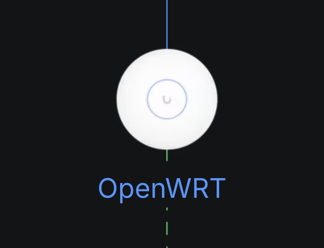

# unifi-openwrt: OpenWrt access points as UniFi access points

Keep your old **OpenWrt** access point useful in a **UniFi** network, long after its maker stopped
supporting it. A small daemon on the AP speaks the UniFi inform protocol, so a UniFi controller adopts
the AP as a UniFi model of your choice (default: UAP-AC-Pro, `U7PG2`), pushes its settings to it, and
shows its clients, radios and stats like those of its own APs: one network, one place to manage it.

<p align="center">
  
</p>

If you like this or find it useful, support the project by buying me a coffee.

<a href="https://www.buymeacoffee.com/antoniocosta" target="_blank"></a>

## Why this repo exists

I own a Google OnHub (TP-Link TGR1900). It is still a capable 3x3 Wi-Fi 5 access point, but Google
ended its support in January 2023: no more updates, no more management through its app, and the
advice to recycle it. OpenWrt brings the software back up to date. My home network, though, is
UniFi, and a UniFi controller only manages Ubiquiti's own access points, so the OnHub would have
stayed a second network with its own settings, its own clients and no roaming between the two. I
don't accept that working hardware should become e-waste, or a second-class citizen in a network,
because its maker moved on.

So this repo does two things:

- **It brings OpenWrt access points into UniFi.** The AP is adopted, configured and monitored from
  the same controller as the Ubiquiti APs: Wi-Fi settings, clients, stats, roaming hints, guest
  portal, VLANs, even meshing when its cable is out. Whatever the hardware can't do is clamped and
  logged, and every change rolls back by itself if the Wi-Fi doesn't come up.
- **It documents.** How the protocol, the settings and the stats work is written up in
  [docs/internals.md](docs/internals.md), so it can be checked, ported to other devices, or carried
  on by anyone.

> **Tested on one device only.** Everything here was tested on a single
> TP-Link OnHub (TGR1900) running OpenWrt 25.12, adopted as a UAP-AC-Pro
> into UniFi Network 10.6 on a UniFi Express 7. Other OpenWrt devices, other
> UniFi models and other controller versions are **best effort**: they may
> work, they have not been tried. Reports are welcome.

**It never applies Ubiquiti firmware.** Upgrade requests from the controller
are answered and ignored; Ubiquiti firmware would brick a non-Ubiquiti
device.

## Setup: point it at your AP, pick a model, click Adopt

1. **Install the package** (OpenWrt 25.12+): build it with `tools/build.sh`
   and `tools/mkapk.sh` (see [docs/packaging.md](docs/packaging.md)), copy
   the `.apk` for your AP's architecture (`cat /etc/apk/arch`) to the AP and run
   `apk add --allow-untrusted ./unifi-openwrt_*.apk`. Then go to step 3.
   The package does not swap a basic `wpad` for the full one: it prints the
   command if you have the basic one.

   **Or** run `tools/build.sh` and copy `dist/openwrt/` (with `bin/`, `files/` and `install.sh`) to the
   AP, for example to `/tmp/uow`, and use the installer (older OpenWrt with
   opkg works too).
2. **Install** with the installer (skip this with the package):

   ```sh
   cd /tmp/uow && sh install.sh
   ```

   The installer checks free flash, replaces a basic `wpad` with the full
   one from the package feed (and restores it on failure), adds the packages
   listed under [Requirements](#requirements), installs `/usr/bin/uow`,
   `/etc/init.d/unifi-openwrt` and `/etc/config/unifi-openwrt` (an existing
   config is kept), and prints the closest UniFi models.
3. **Pick a model.** `uow -models` lists all of them; `uow -ap local
   -suggest` ranks them for this AP (same bands, then Wi-Fi generation, then
   streams). `U7PG2` is the only one with measured capability data.
4. **Configure** `/etc/config/unifi-openwrt`:

   ```sh
   uci set unifi-openwrt.main.model='U7PG2'
   uci set unifi-openwrt.main.inform_url='http://<controller IP>:8080/inform'
   uci set unifi-openwrt.main.apply='0'     # log-only at first (see Safety)
   uci set unifi-openwrt.main.enabled='1'
   uci commit unifi-openwrt
   /etc/init.d/unifi-openwrt enable
   /etc/init.d/unifi-openwrt start
   ```

   The inform URL needs an IP address, not a host name. Other options in the
   file: `hostname`, `profile_caps`, `locate_beep`, `mesh_uplink`,
   `ssh_port` (adoption SSH responder, default 2222), `hw_caps`,
   `inform_every`, `led_idle`.
5. **Adopt.** The AP shows up in the UniFi as pending adoption, with the
   chosen model's name. Click Adopt.
6. **Watch the log:** `logread -e uow`. It shows the adoption, every plan of
   changes, what was applied, clamped or skipped, and each rollback.
   When the plans look right, set `apply '1'` and restart the service.

To stop managing the AP: Remove it in the UniFi (the daemon goes back to
pending; OpenWrt and its Wi-Fi are not reset), then
`/etc/init.d/unifi-openwrt disable; /etc/init.d/unifi-openwrt stop`.

## What works

Tested live on the device above unless marked otherwise.

| UniFi feature | Status |
|---|---|
| Adoption, Remove, adopt again | works (SSH and inform-reply adoption) |
| Firmware update | answered, **never applied** |
| Clients as wireless clients of the AP, with signal, rates, channel width | works |
| Radio and VAP stats, channel use, interference, history graphs, CPU and memory | works |
| Live updates (1 s informs while the panel is open) | works |
| Wi-Fi experience (satisfaction) | partial: PHY-rate and retry sub-scores, as the firmware computes them ([details](docs/internals.md#unifi-ap-satisfaction--wifi-experience-score-how-it-is-computed)) |
| Ethernet ports in the device panel | works (Port Manager; an AC Pro has no port squares) |
| Radios: channel, width, transmit power, country | works |
| Indoor / Outdoor | works (Country IE environment) |
| Minimum RSSI, load balancing (max clients) | works |
| WLANs: SSID, password, WPA2, WPA3, WPA2/WPA3, PMF, hidden, client isolation, U-APSD, DTIM | works |
| MAC filter (allow / deny) | works |
| 802.11r, 802.11k (with a neighbour list of the UniFi's own APs), 802.11v | works; needs the full `wpad` |
| Band steering | works (usteer, local mode) |
| Minimum data rates | clamped: applied per radio, only when every WLAN on that radio asks for it |
| WLAN schedules | works (enforced on the AP) |
| Rate limits (user groups) | works (tc shaping; nftables policing without tc) |
| Guest WLAN: isolation, guest DNS | works |
| Guest portal (hotspot) | works |
| VLANs (WLAN on a tagged network) | works |
| Block, Unblock, Reconnect | works (immediate with `hostapd-utils`) |
| Locate, LED on/off, Restart | works; Locate beeps on APs with a speaker |
| LED colour and brightness | works when `hw_caps` is claimed (not on the AC Pro) |
| Disable device | works |
| IP settings (DHCP / static) | works; a static address other than the current one is refused |
| Device SSH authentication | works (extra login, root untouched) |
| NTP server, timezone | works |
| Remote syslog, including UniFi's encrypted syslog | works |
| SNMP v1/v2c | works; SNMPv3 not built (OpenWrt's snmpd is built without SSL) |
| RF scan, neighbour scan, rogue AP list | works (a spare radio is used when there is one) |
| Mesh: wireless uplink when the cable is out | works; never cable and mesh at once |
| Mesh Parent (choose the uplink AP) | built, **untested live** |
| Serving mesh children, VLANs over mesh | not built |
| Debug terminal, Support file | not built |

Technical notes for contributors are in [docs/](docs/):
[docs/internals.md](docs/internals.md): protocol, config translation, stats,
the satisfaction formula, models and profiles, LED, mesh, VLANs, guest
portal and RF scan.

## Requirements

- OpenWrt with `apk` or `opkg` (tested: 25.12). The daemon is a static Go
  binary of 8-10 MB: APs with 16 MB of flash usually do not have room.
- **Full wpad** (`wpad-mbedtls`, `wpad-wolfssl` or `wpad-openssl`) instead of
  `wpad-basic-*`: needed for 802.11k/v, RADIUS/802.1X and the runtime deny
  list. Install it from the package feed; check with `--simulate` before
  removing the basic one.
- `hostapd-utils` (immediate block/unblock), `kmod-nft-bridge` (guest
  isolation).
- Optional: `usteer` (band steering), `tc-tiny`, `kmod-sched-core`,
  `kmod-sched`, `kmod-ifb` (rate-limit shaping), `snmpd` (SNMP),
  `alsa-utils` (Locate beep).
- A UniFi controller on the same network that the AP can reach on port
  8080, and that can reach the AP's adoption SSH port (default 2222).

## Safety design

- **Log-only mode**: with `apply '0'` (flag: no `-apply`) the daemon only logs
  the changes it would make.
- **Automatic rollback**: before each apply the touched UCI packages are
  backed up and an on-AP timer restores them after 5 minutes unless the
  change is confirmed. 20 s after an apply the daemon checks that every
  enabled radio with interfaces is up; if not, it rolls back at once.
- **Never wired and mesh-uplinked at once**: the mesh watcher joins only
  after 20 s without cable link and drops the wireless uplink within a
  second of a cable coming back.
- **Never applies Ubiquiti firmware**; Remove never resets OpenWrt.
- The AP never starts serving DHCP, DNS or router advertisements on its LAN:
  guest DNS runs on a separate port for guest clients only, VLAN interfaces
  have no address.
- Secrets (WLAN passphrases, the device key, password hashes) go to UCI over
  stdin, never on a command line or in the log; state files are mode 600.
- Only accounts the daemon created itself are touched for Device SSH
  authentication; root and system accounts never are.

## Building from source

Go 1.26 or later.

```sh
go test ./... && go vet ./...
CGO_ENABLED=0 GOOS=linux GOARCH=arm GOARM=7 go build -trimpath -ldflags='-s -w' -o uow ./cmd/uow
```

`tools/build.sh` builds `uow-<arch>` for armv7, aarch64, mipsel, mips
(softfloat) and x86_64 and assembles the installer bundle in `dist/openwrt/`.

## Layout

| Path | What |
|---|---|
| `cmd/uow` | the daemon |
| `cmd/owprobe`, `cmd/owplan`, `cmd/owctl` | development helpers: print the inform fields for an AP over SSH, print the UCI plan for a saved system_cfg, run one AP action |
| `internal/` | protocol (`inform`, `device`), OpenWrt side (`openwrt`), settings translation (`translate`), model catalogue (`models`), read-only UniFi API client (`unifiapi`) |
| `packaging/` | files installed on the AP, `install.sh`, the OpenWrt package Makefile |
| `tools/` | build, `.apk` packaging, model catalogue generator, a small SNMP test client |
| `docs/` | [internals](docs/internals.md), [packaging](docs/packaging.md) |

## Contributing

Issues and pull requests are welcome. It has been tested on one device only, so
reports from other OpenWrt devices, UniFi models and controller versions help
most: say which device, OpenWrt version, model (`-model`) and controller version,
and attach `logread -e uow` with keys and passphrases removed (the daemon never
logs them). Run `go test ./... && go vet ./...` before sending code.

## Credits

This project builds on the work of others:

- [open-unifi](https://github.com/lucavb/open-unifi) by Luca Becker (MIT): its
  protocol documentation is the basis of the inform packet format, the
  controller replies and the system_cfg keys, and its recorded UAP-AC-Pro
  capability words are the `U7PG2` profile.
- [unifi-emu](https://github.com/jamesbraid/unifi-emu) by James Braid (MIT):
  the UniFi model catalogue (`internal/models/catalog.json`) is generated from
  its model profiles, and its protocol notes informed the inform payload.
- [unifi-inform-protocol](https://github.com/jk-5/unifi-inform-protocol) and
  [ubntmfi's inform protocol notes](https://github.com/mcrute/ubntmfi/blob/master/inform_protocol.md):
  early descriptions of the inform protocol and `set-adopt`.
- [OpenWrt](https://openwrt.org), with hostapd, iw, usteer and apk-tools, does
  the actual work on the access point.

Details and license texts are in [NOTICE](NOTICE).

## Legal

Not affiliated with, endorsed by or supported by Ubiquiti or the OpenWrt project. It relies on
unofficial UniFi controller behaviour that Ubiquiti can change in any update. No Ubiquiti software,
firmware or code is included, and it never installs Ubiquiti firmware. UniFi and Ubiquiti are
trademarks of Ubiquiti Inc.; OpenWrt is a trademark of its owner. The names are used only to say what
this software works with.

## License

GPL-2.0-or-later; see [LICENSE](LICENSE). Third-party attributions and license texts are in
[NOTICE](NOTICE).
