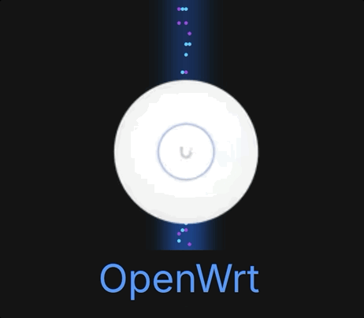

# unifi-openwrt: OpenWrt access points as UniFi access points

Keep your old **OpenWrt** access point useful in a **UniFi** network, long after its maker stopped
supporting it. A small daemon on the AP speaks the UniFi inform protocol, so a UniFi controller adopts
the AP as a UniFi model of your choice (default: UAP-AC-Pro, `U7PG2`), pushes its settings to it, and
shows its clients, radios and stats like those of its own APs: One network, one place to manage it.

<p align="center">
  
</p>

If you like this or find it useful, support the project by buying me a coffee.

<a href="https://www.buymeacoffee.com/antoniocosta" target="_blank"></a>

## Why this repo exists

I own a Google OnHub (TP-Link TGR1900). It is still a capable 3x3 Wi-Fi 5 access point, but Google
ended its support in January 2023: No more updates, no more management through its app, and the
advice to recycle it. OpenWrt brings the software back up to date. My home network, though, is
UniFi, and a UniFi controller only manages Ubiquiti's own access points, so the OnHub would have
stayed a second network with its own settings, its own clients and no roaming between the two. I
don't accept that working hardware should become e-waste, or a second-class citizen in a network,
because its maker moved on.

So this repo does two things:

- **It brings OpenWrt access points into UniFi.** The AP is adopted, configured and monitored from
  the same controller as the Ubiquiti APs: Wi-Fi settings, clients, stats, roaming hints, guest
  portal, VLANs, even meshing when its cable is out. Whatever the hardware can't do is clamped and
  logged, and every change rolls back by itself if the Wi-Fi doesn't come up or the controller is lost.
- **It documents.** How the protocol, the settings and the stats work is written up in
  [docs/internals.md](docs/internals.md), so it can be checked, ported to other devices, or carried
  on by anyone.

> **Tested on five devices only**, listed under
> [Tested devices](#tested-devices). Other OpenWrt devices, other UniFi
> models and other controller versions are **best effort**: They will very
> likely work, they just have not been tried yet. Reports are welcome.

**It never applies Ubiquiti firmware.** Upgrade requests from the controller
are answered and ignored; Ubiquiti firmware would brick a non-Ubiquiti
device.

## Setup: Point it at your AP, pick a model, click Adopt

1. **Install the package** (OpenWrt 25.12+): Build it with `tools/build.sh`
   and `tools/mkapk.sh` (see [docs/packaging.md](docs/packaging.md)), copy
   the `.apk` for your AP's architecture (`cat /etc/apk/arch`) to the AP and run
   `apk add --allow-untrusted ./unifi-openwrt_*.apk`. Then go to step 3.
   The package does not swap a basic `wpad` for the full one: It prints the
   command if you have the basic one.

   **Or** run `tools/build.sh` and copy `dist/openwrt/` (with `bin/`, `files/` and `install.sh`) to the
   AP, for example to `/tmp/uow`, and use the installer (older OpenWrt with
   opkg works too).
2. **Install** with the installer (skip this with the package):

   ```sh
   cd /tmp/uow && sh install.sh
   ```

   The installer checks free flash, replaces a basic `wpad` with the full
   one from the package feed (and restores it on failure), adds the packages
   listed under [Requirements](#requirements), installs `/usr/bin/uow`,
   `/etc/init.d/unifi-openwrt` and `/etc/config/unifi-openwrt` (an existing
   config is kept), and prints the closest UniFi models.
3. **Pick a model.** `uow -models` lists all of them; `uow -ap local
   -suggest` ranks them for this AP (same bands, then Wi-Fi generation, then
   streams). `U7PG2` is the only one with measured capability data.
4. **Configure** `/etc/config/unifi-openwrt`:

   ```sh
   uci set unifi-openwrt.main.model='U7PG2'
   uci set unifi-openwrt.main.inform_url='http://<controller IP>:8080/inform'
   uci set unifi-openwrt.main.apply='0'     # log-only at first (see Safety)
   uci set unifi-openwrt.main.enabled='1'
   uci commit unifi-openwrt
   /etc/init.d/unifi-openwrt enable
   /etc/init.d/unifi-openwrt start
   ```

   Put an IP address into the inform URL: A host name only works if the AP
   can resolve it. Other options in the file: `hostname`, `profile_caps`,
   `locate_beep`, `mesh_uplink`,
   `ssh_port` (adoption SSH responder, default 2222), `hw_caps`,
   `inform_every`, `led_idle`, `uplink_port` (the port that is always the
   uplink, e.g. `wan`), `console` (one more address that may adopt over SSH;
   the controller in the inform URL always may), `ft_relay` (fast roaming
   with UniFi APs, on by default) and `ft_verbose`.
5. **Adopt.** The AP shows up in the UniFi as pending adoption, with the
   chosen model's name. Click Adopt.
6. **Watch the log:** `logread -e uow`. It shows the adoption, every plan of
   changes, what was applied, clamped or skipped, and each rollback.
   When the plans look right, set `apply '1'` and restart the service.

To stop managing the AP: Remove it in the UniFi (the daemon goes back to
pending; OpenWrt and its Wi-Fi are not reset), then
`/etc/init.d/unifi-openwrt disable; /etc/init.d/unifi-openwrt stop`.

## Tested devices

Running it on another device? Open an issue or a pull request with the
device, the OpenWrt version, the UniFi model, the UniFi Network version and
console, and what you tested, and it gets a row here.

| Device | Hardware | OpenWrt | Adopted as | UniFi | Tested |
|---|---|---|---|---|---|
| [Google OnHub (TP-Link TGR1900)](https://openwrt.org/inbox/toh/google/onhub_tp-link_tgr1900) | Qualcomm IPQ8064, Wi-Fi 5 | 25.12.6 | UAP-AC-Pro (`U7PG2`) | Network 10.6 on an Express 7 | By [@antoniocosta](https://github.com/antoniocosta): Everything under [What works](#what-works) unless marked otherwise |
| [Linksys LN1301 (MX4300)](https://openwrt.org/toh/linksys/mx4300) | Qualcomm IPQ8174 (`ath11k`), Wi-Fi 6, one 2.4 GHz and two 5 GHz radios | 25.12.6 | U6-IW | Not reported | By [@dohun0310](https://github.com/dohun0310): Wired, as an AP and small switch. Package install and adoption, all three radios, the 160 MHz option, wired clients on the LAN ports, in-wall port numbering |
| [Linksys E4200 v2](https://openwrt.org/toh/hwdata/linksys/linksys_e4200_v2) | Marvell Kirkwood, 2x 88W8366 (`mwl8k`), Wi-Fi 4 | 23.05.6 | UAP Pro (`U7P`) | Network 11.1.50 on a UCG Ultra | By [@rbferreira](https://github.com/rbferreira): Package install, SSH adoption with the controller on another address, the rollback timer, mesh uplink to a UniFi AP (a U7 Lite) |
| [TP-Link Archer BE800](https://forum.openwrt.org/t/openwrt-for-tp-link-be800/227055) | Qualcomm IPQ9574 (`ath12k`), Wi-Fi 7, one phy for 2.4, 5 and 6 GHz | Snapshot | U7 Pro (`U7PRO`) | Not reported | By [@Kelon5212001](https://github.com/Kelon5212001): Adoption, all three radios, WLANs applied. Tested on 0.2.0 plus the fixes; confirmation on the merged code is pending. The mesh uplink joins but does not pass traffic (driver limit) |
| [D-Link DIR-878 A1](https://openwrt.org/toh/d-link/dir-878_a1) | MediaTek MT7621, Wi-Fi 5 | 25.12.6 | UAP-AC-Pro (`U7PG2`) | Network 10.6.109 | By [@Lukas-Heiligenbrunner](https://github.com/Lukas-Heiligenbrunner): SSH adoption after the inform address changed, and "Override inform host" set to a name; the neighbour list next to two UAP-AC-Pros and a U7 Lite |

## What works

 Works &nbsp;  Partial, limited or not tested live &nbsp;  Not built

Tested live on the OnHub unless marked otherwise (see [Tested devices](#tested-devices)).

| UniFi feature | Status |
|---|---|
| Adoption, Remove, adopt again |  Works (SSH and inform-reply adoption) |
| Firmware update |  Answered, **never applied**: Nothing is downloaded; the offered version is reported so the controller stops asking (never offered in testing) |
| Clients as wireless clients of the AP, with signal, rates, channel width, spatial streams, transmit power and retries |  Works |
| Radio and VAP stats, channel use, interference, history graphs, CPU and memory |  Works. On `mwl8k` radios (Marvell 88W8366) channel use does not update: The driver only gives one sample from the last channel change. Reported by [@rbferreira](https://github.com/rbferreira) |
| Live updates (1 s informs while the panel is open) |  Works |
| Wi-Fi experience (satisfaction) |  Partial: PHY-rate and retry sub-scores, as the firmware computes them ([details](docs/internals.md#unifi-ap-satisfaction--wifi-experience-score-how-it-is-computed)) |
| Ethernet ports in the device panel |  Works (Port Manager; an AC Pro has no port squares) |
| Wired clients on the AP's LAN ports |  Works; tested by [@dohun0310](https://github.com/dohun0310) on the Linksys LN1301, not on the OnHub; in-wall models only (U6-IW and the others with the `ACCESS_POINT_SWITCH` feature) |
| Radios: Channel, width, transmit power, country |  Works. Power as Auto, High or Custom; Medium and Low are the maximum minus 6 and 12 dB (Ubiquiti does not publish its values). By [@Lukas-Heiligenbrunner](https://github.com/Lukas-Heiligenbrunner); Medium and Low were not tested on the OnHub |
| Indoor / Outdoor |  Works (Country IE environment) |
| Minimum RSSI, load balancing (max clients) |  Works |
| WLANs: SSID, password, WPA2, WPA3, WPA2/WPA3, PMF, hidden, client isolation, U-APSD, DTIM |  Works (WPA3-only untested live) |
| WPA-Enterprise (RADIUS), Enhanced Open (OWE), WEP, private pre-shared keys |  Not built: Such a WLAN is left off, never opened with other security |
| MAC filter (allow / deny) |  Works |
| 802.11k, 802.11v |  Works; needs the full `wpad`. The neighbour list is built from the AP's own scans: Its own other-band BSSes and the same SSID on other APs of the LAN, genuine UniFi APs included |
| 802.11r (fast transition) |  Works, also between this AP and genuine UniFi APs, in both directions: The daemon relays the key exchange between the two and speaks UniFi's roam announcements. Tested with a WPA3 client against a UniFi Express 7 (120 to 150 ms per roam). The Wi-Fi configuration stays stock, so the Wi-Fi also starts without the daemon. Each key type (WPA2, WPA3) gets fast roaming only if the WLAN's other APs offer it too; see [internals](docs/internals.md#80211r-fast-roaming-with-unifi-aps) |
| Band steering |  Works (usteer, local mode) |
| Roaming Assistant |  Built, **untested live**: 802.11v BSS transition requests to weak clients that support them, never a disconnect; needs the full `wpad` |
| Minimum data rates |  Clamped: Applied per radio, only when every WLAN on that radio asks for it |
| WLAN schedules |  Works (enforced on the AP) |
| Rate limits (user groups) |  Works (tc shaping; nftables policing without tc) |
| Guest WLAN: Isolation, guest DNS |  Works |
| Guest portal (hotspot) |  Works |
| VLANs (WLAN on a tagged network) |  Works |
| Block, Unblock, Reconnect |  Works (immediate with `hostapd-utils`) |
| Locate, LED on/off, Restart |  Works; Locate beeps on APs with a speaker |
| LED colour and brightness |  Works on APs with LEDs that can show it (tested on an RGB LED ring). The UniFi only offers it when the AP claims the ability: Set `hw_caps` (the AC Pro itself has none). With `led_idle 'rainbow'` the colour shows only until the rainbow takes over |
| Disable device |  Works |
| IP settings (DHCP / static) |  Works; a static address other than the current one is refused |
| Device SSH authentication |  Works (extra login, root untouched) |
| NTP server, timezone |  Works. The AP's clock is also compared with the controller's and repaired when it is off |
| Remote syslog, including UniFi's encrypted syslog |  Works |
| SNMP v1/v2c |  Works; SNMPv3 not built (OpenWrt's snmpd is built without SSL) |
| RF scan, neighbour scan, rogue AP list |  Works (a spare radio is used when there is one) |
| Mesh: Wireless uplink when the cable is out |  Works; never cable and mesh at once. On `mwl8k` radios (Marvell 88W8366) the uplink passes traffic only while the 5 GHz radio also carries a WLAN. On `ath12k` (reported on a TP-Link Archer BE800, OpenWrt snapshot) the uplink joins but almost no data gets through |
| Mesh Parent (choose the uplink AP) |  Built, **untested live** |
| Serving mesh children, VLANs over mesh |  Not built |
| Debug terminal |  Not built, on purpose: It would be a root shell on the AP, opened through a third party's relay servers. OpenWrt has SSH and LuCI. The UniFi's window stays on "Connecting" until you close it |
| Support file |  Not built, on purpose: The bundle is meant for Ubiquiti's support, which does not cover this AP. For a report to this project use `uow -dump`. The UniFi shows "Generating" for three minutes and then gives up (refresh the page) |
| LLDP neighbours (what is on the other end of each cable) |  Works with the optional `lldpd` package, which also announces the AP to the switch: The controller then takes the AP's uplink from LLDP. lldpd must listen on the Ethernet ports themselves: `uci add_list lldpd.config.interface=lan1` (your port names), `uci commit lldpd`, `/etc/init.d/lldpd restart` |
| Discovery broadcast (the AP showing up by itself, before it has the controller's address) |  Not built: The AP is given the address. A controller that finds a device this way adopts it by logging in on its SSH port 22 as `ubnt`, which this project leaves alone |
| DFS radar events |  Not built |

Technical notes for contributors are in [docs/](docs/):
[Docs/internals.md](docs/internals.md): Protocol, config translation, stats,
the satisfaction formula, models and profiles, LED, mesh, VLANs, guest
portal, RF scan and fast roaming with UniFi APs.

## How it is tested

In three ways, from fast to real:

- **Unit tests** (`go test ./...`): The protocol, the settings translation
  and readings of real devices kept as test data. A dump of your device
  (`uow -dump`, see [Contributing](#contributing)) adds it to them.
- **Virtual machines** (last run for v0.2.2). The daemon runs on OpenWrt x86/64
  with two simulated radios (`mac80211_hwsim`) against a real, self-hosted
  UniFi Network controller, on a network that exists only between the two
  virtual machines. On each OpenWrt version it is installed (the released
  `.apk`, or `install.sh` where the package manager is `opkg`), adopted,
  upgraded while adopted, given a WLAN that must come up on both radios,
  forgotten and adopted again, cut off from the controller on purpose to
  see the rollback, and removed.
- **Real hardware**: The devices under [Tested devices](#tested-devices).

| OpenWrt | UniFi Network 10.6.109 | UniFi Network 10.0.160 |
|---|---|---|
| 25.12.6 | Passes | Passes |
| 24.10.8 | Passes | Not run |
| 23.05.6 | Passes | Not run |
| Snapshot | Passes | Not run |

What this does not show: A simulated radio behaves like one well-behaved
driver, so what a real Wi-Fi driver cannot do (see the mesh notes above)
and how a real radio performs only show on hardware. The runs are started
by hand before a release, not on every commit, and their set-up is not
part of this repository.

## Requirements

- OpenWrt with `apk` or `opkg` (tested: 25.12, 24.10 and 23.05). The daemon is a static Go
  binary of 8-10 MB: APs with 16 MB of flash usually do not have room.
- **The Wi-Fi radios switched on in OpenWrt.** Up to OpenWrt 24.10 a fresh
  install has them off (`uci set wireless.radio0.disabled=0`, the same for
  the other radios, then `uci commit wireless; wifi`). A radio that is
  switched off is left alone and not shown in the UniFi, which is also the
  way to keep a radio out of it; the daemon's log says so at start.
- **Full wpad** (`wpad-mbedtls`, `wpad-wolfssl` or `wpad-openssl`) instead of
  `wpad-basic-*`: Needed for 802.11k/v and the runtime deny
  list. Install it from the package feed; check with `--simulate` before
  removing the basic one.
- `hostapd-utils` (immediate block/unblock), `kmod-nft-bridge` (guest
  isolation), `kmod-veth` (fast roaming with UniFi APs).
- Optional: `usteer` (band steering), `tc-tiny`, `kmod-sched-core`,
  `kmod-sched`, `kmod-ifb` (rate-limit shaping), `snmpd` (SNMP),
  `alsa-utils` (Locate beep), `lldpd` (LLDP neighbours).
- A UniFi controller on the same network that the AP can reach on port
  8080, and that can reach the AP's adoption SSH port (default 2222).

## Safety design

- **Log-only mode**: With `apply '0'` (flag: No `-apply`) the daemon only logs
  the changes it would make.
- **Automatic rollback**: Before each apply the touched UCI packages are
  backed up and an on-AP timer restores them after 5 minutes unless the
  change is confirmed. 20 s after an apply (2 s after MAC list changes made
  in hostapd) the daemon checks that every enabled radio with interfaces is
  up and that the controller can still be reached; if not, it rolls back at
  once.
- **MAC lists without a Wi-Fi restart**: A plan that changes only MAC filters
  (Lock to AP, MAC filter) is applied in the running hostapd; only the
  clients it denies are disconnected.
- **Never wired and mesh-uplinked at once**: The mesh watcher joins only
  after 20 s without cable link and drops the wireless uplink within a
  second of a cable coming back.
- **Never applies Ubiquiti firmware**; Remove never resets OpenWrt.
- The AP never starts serving DHCP, DNS or router advertisements on its LAN:
  Guest DNS runs on a separate port for guest clients only, VLAN interfaces
  have no address.
- Secrets (WLAN passphrases, the device key, password hashes) go to UCI over
  stdin, never on a command line or in the log; state files are mode 600.
- Only accounts the daemon created itself are touched for Device SSH
  authentication; root and system accounts never are.

## Building from source

Go 1.26 or later. To build just the daemon for an AP without cloning, for example an ARMv7 one:

```sh
GOOS=linux GOARCH=arm GOARM=7 CGO_ENABLED=0 go install github.com/antoniocosta/unifi-openwrt/cmd/uow@latest
# the binary lands in $(go env GOPATH)/bin/linux_arm/uow
```

From a clone:

```sh
go test ./... && go vet ./...
CGO_ENABLED=0 GOOS=linux GOARCH=arm GOARM=7 go build -trimpath -ldflags='-s -w' -o uow ./cmd/uow
```

`tools/build.sh` builds `uow-<arch>` for armv7, aarch64, mipsel, mips
(softfloat) and x86_64 and assembles the installer bundle in `dist/openwrt/`.

## Layout

| Path | What |
|---|---|
| `cmd/uow` | The daemon |
| `cmd/owprobe`, `cmd/owplan`, `cmd/owctl` | Development helpers: Print the inform fields for an AP over SSH, print the UCI plan for a saved system_cfg, run one AP action |
| `internal/` | Protocol (`inform`, `device`), OpenWrt side (`openwrt`), settings translation (`translate`), model catalogue (`models`), read-only UniFi API client (`unifiapi`) |
| `packaging/` | Files installed on the AP, `install.sh`, the OpenWrt package Makefile |
| `tools/` | Build, `.apk` packaging, model catalogue generator, a small SNMP test client |
| `docs/` | [Internals](docs/internals.md), [packaging](docs/packaging.md) |

## Contributing

Issues and pull requests are welcome. It has been tested on a few devices only (see [Tested devices](#tested-devices)), so
reports from other OpenWrt devices, UniFi models and controller versions help
most: Say which device, OpenWrt version, model (`-model`) and controller version,
and attach `logread -e uow` with keys and passphrases removed (the daemon never
logs them).

A dump of what the daemon reads from your AP helps even more, because it
becomes a test case for your device:

```sh
uow -dump /tmp/uow-dump.txt
```

MAC and IP addresses, SSIDs and the hostname are replaced by made-up ones,
and Wi-Fi passwords and every text field the daemon does not know are left
out. Read the file before you attach it.

Run `go test ./... && go vet ./...` before sending code.

## Credits

This project builds on the work of others:

- [open-unifi](https://github.com/lucavb/open-unifi) by Luca Becker (MIT): Its
  protocol documentation is the basis of the inform packet format, the
  controller replies and the system_cfg keys, and its recorded UAP-AC-Pro
  capability words are the `U7PG2` profile.
- [unifi-emu](https://github.com/jamesbraid/unifi-emu) by James Braid (MIT):
  The UniFi model catalogue (`internal/models/catalog.json`) is generated from
  its model profiles, and its protocol notes informed the inform payload.
- [unifi-inform-protocol](https://github.com/jk-5/unifi-inform-protocol) and
  [ubntmfi's inform protocol notes](https://github.com/mcrute/ubntmfi/blob/master/inform_protocol.md):
  Early descriptions of the inform protocol and `set-adopt`.
- [OpenWrt](https://openwrt.org), with hostapd, iw, usteer and apk-tools, does
  the actual work on the access point.

Contributors:

- [@dohun0310](https://github.com/dohun0310): Wired clients on the AP's LAN
  ports, the uplink port setting and in-wall port numbering, tested on a
  Linksys LN1301; radio reporting and the Wi-Fi 6, 802.11v and 160 MHz
  fixes.
- [@rbferreira](https://github.com/rbferreira): The rollback timer without
  `setsid`, adoption from the inform address, the mesh parent lookup and a
  mesh uplink that recovers after a reboot, tested on a Linksys E4200 v2.
- [@Kelon5212001](https://github.com/Kelon5212001): Radios that share one
  phy (`ath12k`) and the mesh watcher's cable check, tested on a TP-Link
  Archer BE800.
- [@Lukas-Heiligenbrunner](https://github.com/Lukas-Heiligenbrunner):
  Adoption over SSH from a controller whose inform address changed, and
  informing to a host name the AP cannot resolve, tested on a D-Link
  DIR-878.

Similar projects:

- [openUF](https://github.com/yesrab/openUF) (Lua, runs on the AP; continues
  [jonasevcik/openUF](https://github.com/jonasevcik/openUF) and the original
  [trueserve/openUF](https://github.com/trueserve/openUF)): The same goal,
  with a guided installer, a LuCI app, discovery, WPA-Enterprise and more
  tested boards.
- [rrb-unifi](https://github.com/d-malinowski/unifi-openwrt-roaming): 802.11r
  fast roaming between OpenWrt and genuine UniFi access points, for an
  OpenWrt AP that is not managed by the UniFi. It found and documented the
  frame formats this project's own relay is built on.
- [@rbferreira's fork](https://github.com/rbferreira/unifi-openwrt/tree/airport):
  An Apple AirPort base station reported to the UniFi, read-only. Not
  supported here.

Details and license texts are in [NOTICE](NOTICE).

## Legal

Not affiliated with, endorsed by or supported by Ubiquiti or the OpenWrt project. It relies on
unofficial UniFi controller behaviour that Ubiquiti can change in any update. No Ubiquiti software,
firmware or code is included, and it never installs Ubiquiti firmware. UniFi and Ubiquiti are
trademarks of Ubiquiti Inc.; OpenWrt is a trademark of its owner. The names are used only to say what
this software works with.

## License

GPL-2.0-or-later; see [LICENSE](LICENSE). Third-party attributions and license texts are in
[NOTICE](NOTICE).
